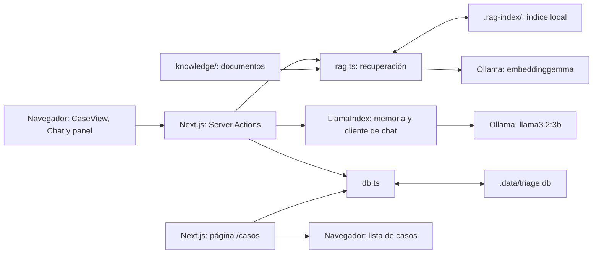

# 03. Arquitectura y componentes

[Índice general](../README.md) · [Anterior: instalación](02-instalacion-y-configuracion.md) · [Siguiente: flujo de un caso](04-flujo-de-un-caso.md)

## Índice

- [Vista del sistema](#vista-del-sistema)
- [Mapa del repositorio](#mapa-del-repositorio)
- [Interfaz y rutas](#interfaz-y-rutas)
- [Servidor y contratos](#servidor-y-contratos)
- [Límites de ejecución](#límites-de-ejecución)
- [Referencias](#referencias)

## Vista del sistema

Next.js contiene tanto la interfaz como las funciones de servidor. El navegador invoca Server Actions; el servidor consulta documentos, llama a Ollama y escribe SQLite. No hay un backend Python ni una API REST propia separada en este repositorio.



LlamaIndex conecta dos recorridos: generación con el modelo conversacional y búsqueda mediante embeddings. El índice vectorial y la base SQLite son almacenes distintos. SQLite no participa en la búsqueda de documentos ni reconstruye automáticamente la memoria del modelo.

## Mapa del repositorio

```text
src/
  app/
    layout.tsx                Idioma, fuentes y metadatos
    page.tsx                  Entrada de Nuevo caso
    actions.ts                Chat, prompts, validación y acciones de guardado
    casos/page.tsx            Lista de casos guardados
    globals.css               Estilos globales
  components/
    CaseView.tsx              Coordinación de la entrevista
    Chat.tsx                  Mensajes, entrada de texto e indicador de espera
    RecommendationPanel.tsx   Recomendación y acciones del profesional
    Nav.tsx                   Navegación
  lib/
    rag.ts                    Lectura, índice y recuperación
    db.ts                     Esquema SQLite y operaciones de persistencia
    manchester.ts             Claves, etiquetas y colores de niveles
knowledge/                    Archivos que el recuperador puede indexar
docs/                         Guías, decisiones, especificaciones y tickets
public/                       Recursos estáticos
.env.example                  Variables de Ollama
package.json                  Dependencias y scripts
pnpm-lock.yaml                Resolución de dependencias
pnpm-workspace.yaml           Configuración de pnpm y compilación de dependencias
```

Las rutas de datos se resuelven con `process.cwd()`, de modo que el directorio de ejecución debe ser la raíz del proyecto. Las carpetas generadas se detallan en [instalación](02-instalacion-y-configuracion.md#archivos-generados).

## Interfaz y rutas

| Módulo | Responsabilidad |
| --- | --- |
| [app/page.tsx](../../src/app/page.tsx) | Renderiza la vista principal |
| [CaseView.tsx](../../src/components/CaseView.tsx) | Mantiene caso activo, mensajes, última recomendación y estado de espera; inicia casos y envía turnos |
| [Chat.tsx](../../src/components/Chat.tsx) | Mantiene el texto del compositor; muestra mensajes y delega envío/inicio a CaseView |
| [RecommendationPanel.tsx](../../src/components/RecommendationPanel.tsx) | Interpreta recomendaciones, conserva decisiones humanas, edita datos y solicita guardados |
| [Nav.tsx](../../src/components/Nav.tsx) | Enlaza `/casos` y `/`; en la vista principal, Nuevo caso activa el flujo de inicio/descarte |
| [casos/page.tsx](../../src/app/casos/page.tsx) | Lee SQLite en el servidor con `force-dynamic` y muestra casos no descartados |
| [layout.tsx](../../src/app/layout.tsx) | Configura español, fuentes Libre Franklin/IBM Plex Mono y metadatos |

`CaseView`, `Chat` y `RecommendationPanel` son componentes de cliente. El panel comunica el nombre y los signos manuales a CaseView mediante `onClinicianDataChange`; CaseView los adjunta al próximo turno. Cambiar esos campos no dispara una inferencia por sí solo.

## Servidor y contratos

[actions.ts](../../src/app/actions.ts) declara `"use server"`. Sus operaciones principales son:

| Función | Entrada y resultado relevante |
| --- | --- |
| `createCase(discardId?)` | Crea un caso y, opcionalmente, marca otro como descartado; devuelve `{ number, startedAt }` |
| `startCase(caseId)` | Reinicia la memoria, prepara el índice en segundo plano y genera la apertura |
| `chat(caseId, query, clinicianData?)` | Recupera contexto, genera una respuesta y guarda el turno |
| `saveDecision(caseId, decision, nivel)` | Valida y guarda decisión y nivel final, o limpia ambos |
| `saveNote(caseId, note)` | Guarda la nota; una nota en blanco pasa a `null` |
| `savePatientName(caseId, name)` | Guarda el nombre recortado; vacío pasa a `null` |
| `resetChatEngine()` | Descarta el motor compartido y su memoria |

`chat` y `startCase` devuelven `{ response, recommendation }`: prosa visible y objeto validado o `null`. El esquema de recomendación se declara en el servidor y se duplica en [CaseView.tsx](../../src/components/CaseView.tsx) para los componentes. Si cambia, hay que revisar ambos lados y el prompt.

[rag.ts](../../src/lib/rag.ts) expone `getIndex`, `warmIndex` y `retrieveContext`. [db.ts](../../src/lib/db.ts) contiene las consultas SQL. Estos módulos se consumen desde el servidor; no se presentan como acciones invocables por el navegador.

## Límites de ejecución

`chatEngine` es un singleton de módulo: un solo motor con memoria para las solicitudes de ese proceso. El `caseId` selecciona dónde guardar el resultado, pero no selecciona una memoria conversacional independiente. Iniciar otro caso resetea ese motor.

El índice también se comparte en el proceso, lo cual permite reutilizar el mismo corpus entre casos. Su promesa `building` evita construcciones simultáneas dentro de ese proceso; no es un bloqueo entre varios servidores. La base de datos mantiene una conexión `DatabaseSync` abierta de manera perezosa.

La protección `requestPending` de CaseView evita envíos repetidos desde esa instancia de la interfaz, pero no coordina otras pestañas o usuarios. No hay autenticación ni separación por usuario. La implementación actual debe entenderse como un prototipo de uso secuencial.

## Referencias

- [Ollama y contrato de respuestas](05-integracion-ollama.md).
- [Construcción y consulta del índice](06-rag.md).
- [Estado y persistencia](07-persistencia-y-estado.md).
- [Índice de decisiones de arquitectura](../adr/README.md).

[Volver al índice general](../README.md)
