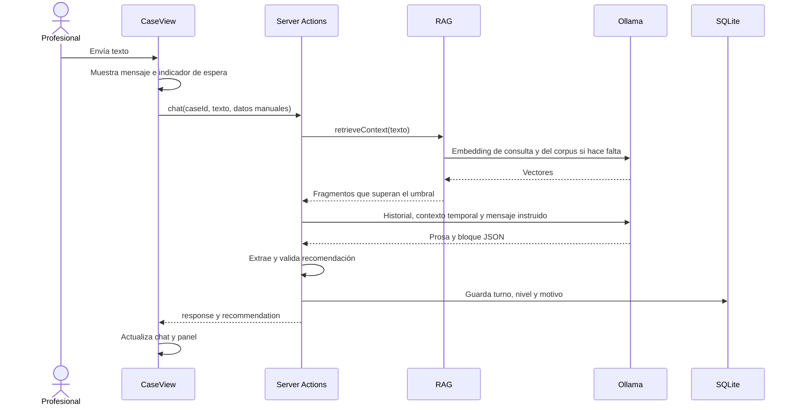

# 04. Flujo de un caso

[Índice general](../README.md) · [Anterior: arquitectura](03-arquitectura-y-componentes.md) · [Siguiente: Ollama](05-integracion-ollama.md)

## Índice

- [Inicio y apertura](#inicio-y-apertura)
- [Recorrido de un mensaje](#recorrido-de-un-mensaje)
- [Actualización del panel](#actualización-del-panel)
- [Intervención del profesional](#intervención-del-profesional)
- [Descarte y consulta](#descarte-y-consulta)
- [Fallos y recarga](#fallos-y-recarga)
- [Referencias](#referencias)

## Inicio y apertura

Al montar [CaseView](../../src/components/CaseView.tsx), el caso activo es `null`, los mensajes están vacíos y el panel no permite acciones. **Iniciar caso**, o **Nuevo caso** sin caso activo, ejecuta:

1. Bloqueo local de solicitudes repetidas mediante `requestPending` y activación del indicador de espera.
2. `createCase()`: SQLite asigna un número y una fecha. En una base nueva, el primer número es 2451.
3. Limpieza del chat y recomendación, y montaje del panel para el nuevo número.
4. `startCase(caseId)`: descarta la memoria del motor y llama a `warmIndex()` sin esperar que termine.
5. Envío del prompt inicial fijo, que solicita una pregunta a la vez. La apertura no hace búsqueda RAG.
6. Guardado de la respuesta visible de la IA y de nivel/motivo, si los produjo. El prompt inicial no se guarda en SQLite ni se muestra al profesional.

El caso existe antes de la inferencia; un error del modelo no elimina el registro creado.

## Recorrido de un mensaje

El diagrama representa un turno exitoso con corpus disponible. La búsqueda usa únicamente el texto escrito en el chat, no los signos manuales, el historial ni las instrucciones JSON. Los datos del panel se agregan después, como contexto de generación.

El mensaje del profesional aparece inmediatamente en pantalla. La base de datos se actualiza después de la respuesta del modelo, guardando juntos el mensaje original y la prosa de la IA. Ver [persistencia](07-persistencia-y-estado.md) para las diferencias entre memoria y base de datos cuando algo falla.

## Actualización del panel

La recomendación llega a [RecommendationPanel](../../src/components/RecommendationPanel.tsx), que mantiene su propia representación visible:

| Situación | Resultado |
| --- | --- |
| Recomendación `null` | Se conserva el panel anterior |
| Objeto válido con campos | Reemplaza los campos mostrados; los omitidos vuelven a sus placeholders |
| Objeto sin `nivel` | Excepción: conserva conjuntamente el nivel y la confianza anteriores |
| Nuevo `nivel` sin `confianza` | Cambia el nivel y la confianza queda sin dato |
| Nivel elegido por el profesional | La IA puede cambiar su sugerencia, pero no desplaza el nivel humano mostrado |
| Signo corregido manualmente | Prevalece sobre el de IA con la misma etiqueta, ignorando mayúsculas y espacios extremos |

El panel no acumula todos los campos de todas las respuestas. Esa distinción explica por qué puede desaparecer un antecedente omitido en un turno válido, aunque persista el nivel.

## Intervención del profesional

| Acción | Efecto visible y persistente |
| --- | --- |
| Elegir nivel desde la tarjeta | Selección provisional local; no guarda ese nivel. Si había una decisión, la limpia en SQLite |
| Aceptar | Guarda `aceptado` y el nivel mostrado, incluso si fue elegido manualmente |
| Anular | Abre un selector; al elegir guarda `anulado` y el nivel elegido |
| Anular después de aceptar | Requiere un segundo clic en el botón dentro de 4 segundos para abrir el selector |
| Deshacer | Disponible 2,8 segundos en el aviso de aceptar/anular; limpia la decisión y devuelve el nivel al control de IA |
| Editar nombre | Se guarda al perder foco; Enter también provoca pérdida de foco |
| Editar signos vitales | Cambia el estado local y el contexto del próximo turno; no guarda signos estructurados en SQLite |
| Quitar mi dato | Retira la versión manual de un signo; puede reaparecer la versión de IA |
| Agregar nota | Se guarda al perder foco o cerrar el campo de nota |

Deshacer actúa sobre la decisión más reciente, no sobre una pila de acciones. La confianza se oculta cuando hay un nivel elegido por el profesional. Si la IA propone otro, aparece la indicación «IA sugiere».

El modelo recibe nombre y signos manuales en cada turno posterior, pero no recibe automáticamente la nota ni la decisión humana del panel. La prioridad de la decisión se aplica en la interfaz y la persistencia; no impide que el modelo continúe proponiendo otro nivel.

## Descarte y consulta

Con un caso activo, **Nuevo caso** abre una confirmación. Al confirmar, `createCase(activeCase.number)` marca el anterior como `descartado` y crea el siguiente en una misma transacción. Después se limpia la interfaz y se reinicia la memoria conversacional para abrir la nueva entrevista.

La base conserva los mensajes, la nota y la decisión del caso descartado. El índice RAG permanece disponible para otros casos. Aunque el diálogo de la interfaz dice que se perderán los datos, esa pérdida se refiere a la sesión visible, no a un borrado físico en SQLite.

**Casos abiertos** lista `status = 'en_curso'` por identificador descendente. Prioriza el nivel humano guardado; en su ausencia muestra el último nivel de IA. Confirmar un nivel no cierra el caso: el esquema solo distingue `en_curso` y `descartado`.

## Fallos y recarga

Si falla la creación, no se reemplaza el caso visible. Si ya había uno, se agrega una burbuja de error; desde la pantalla vacía no hay un mensaje de error específico. Si falla la apertura después de crear el registro, queda un caso activo con una burbuja de error.

La interfaz actual no tiene el botón **Reintentar** descrito en el ticket 13. El compositor permite enviar un mensaje al caso iniciado. Una nueva apertura desde **Nuevo caso** descarta ese caso y crea otro.

Un error de chat conserva el mensaje enviado en pantalla y agrega «No se pudo obtener una respuesta. Intentá de nuevo.». No guarda esa burbuja. Los fallos al guardar decisiones, nombre o nota se registran en consola sin revertir el panel; nombre y nota pueden volver a intentar el guardado en una siguiente pérdida de foco si quedaron pendientes.

Recargar la página pierde el estado local. Los registros permanecen en SQLite, pero no existe un flujo de restauración de la entrevista. Navegar a la lista y volver tampoco constituye una reapertura soportada.

## Referencias

- [CaseView](../../src/components/CaseView.tsx), [Chat](../../src/components/Chat.tsx) y [panel](../../src/components/RecommendationPanel.tsx).
- [ADR 0005: precedencia humana](../adr/0005-panel-reconciliation-and-human-precedence.md).
- [ADR 0010: persistencia](../adr/0010-cases-persisted-in-local-sqlite.md) y [ADR 0011: edición](../adr/0011-clinician-edits-in-the-panel.md).

[Volver al índice general](../README.md)
