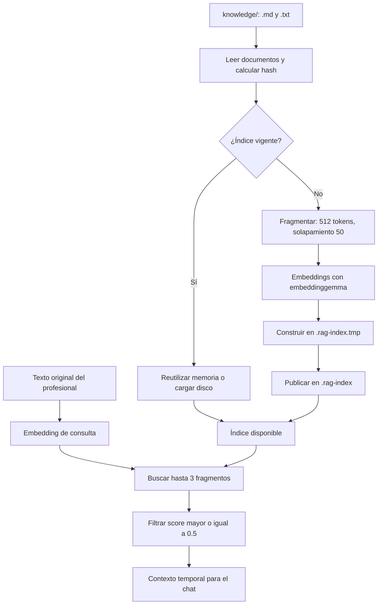

# 06. RAG: documentos, índice y recuperación

[Índice general](../README.md) · [Anterior: Ollama](05-integracion-ollama.md) · [Siguiente: persistencia](07-persistencia-y-estado.md)

## Índice

- [Qué aporta el RAG](#qué-aporta-el-rag)
- [Corpus y lectura](#corpus-y-lectura)
- [Fragmentación y embeddings](#fragmentación-y-embeddings)
- [Persistencia e invalidación del índice](#persistencia-e-invalidación-del-índice)
- [Preparación y concurrencia](#preparación-y-concurrencia)
- [Recuperación por turno](#recuperación-por-turno)
- [Ejemplo completo](#ejemplo-completo)
- [Actualizar la base de conocimiento](#actualizar-la-base-de-conocimiento)
- [Límites y diferencias con las propuestas](#límites-y-diferencias-con-las-propuestas)
- [Referencias](#referencias)

## Qué aporta el RAG

RAG significa generación aumentada con recuperación. Antes de generar una respuesta, el servidor busca fragmentos próximos al mensaje del profesional y los entrega al modelo como referencia. No entrena el modelo ni garantiza que su respuesta derive únicamente de esos fragmentos.

La implementación vive en [rag.ts](../../src/lib/rag.ts). Utiliza `Document`, `SentenceSplitter`, `VectorStoreIndex` y almacenamiento de LlamaIndex; los vectores se generan mediante `OllamaEmbedding`. No hay una base vectorial externa como Chroma o Qdrant.

La primera mitad construye o abre el índice. La segunda consulta ese índice por turno; los documentos no se vuelven a embeber en cada consulta si ya hay un índice vigente.

## Corpus y lectura

`readKnowledgeDocuments()` lee `knowledge/` desde la raíz de ejecución:

- Incluye archivos `.md` y `.txt`, sin distinguir mayúsculas de la extensión.
- Solo inspecciona archivos directamente dentro de esa carpeta; no recorre subcarpetas.
- Ordena los nombres, lee UTF-8 y omite archivos de contenido vacío o solo espacios.
- Crea un `Document` por archivo, con identificador igual al nombre y metadata `{ fileName }`.
- Si la carpeta no existe, devuelve un corpus vacío. Otros errores de lectura se propagan.

No hay parser de front matter: los encabezados YAML de los documentos forman parte del texto. No se convierten en filtros por población, versión, tipo o aprobación. Tampoco existe una lista de exclusiones: un archivo de prueba o una especificación `.md` en esa carpeta entra en el corpus igual que cualquier otro.

## Fragmentación y embeddings

| Parámetro | Valor en el código | Función |
| --- | --- | --- |
| `CHUNK_SIZE` | `512` | Tamaño objetivo de fragmentos en tokens para `SentenceSplitter` |
| `CHUNK_OVERLAP` | `50` | Solapamiento configurado entre fragmentos |
| Modelo | `OLLAMA_EMBED_MODEL` o `embeddinggemma` | Genera vectores de documentos y consultas |
| Host | `OLLAMA_BASE_URL` o `http://127.0.0.1:11434` | Servicio Ollama para embeddings |
| `TOP_K` | `3` | Máximo de candidatos solicitado al recuperador |
| `SIMILARITY_THRESHOLD` | `0.5` | Puntaje mínimo aceptado después de recuperar |

`SentenceSplitter` proporciona división de texto con solapamiento; el código no agrega reglas propias para respetar tablas, secciones clínicas o excepciones. El umbral está marcado como provisional y sin calibrar.

La construcción usa `Settings.withNodeParser` y `Settings.withEmbedModel` para acotar la configuración a la operación. El índice conserva el modelo de embeddings con el que se construyó o cargó para representar las consultas posteriores. Cambiar el modelo conversacional no obliga a recalcular estos vectores; cambiar el de embeddings sí puede hacerlo.

## Persistencia e invalidación del índice

El índice vive en `.rag-index/`; `knowledge.hash` identifica con qué datos se construyó. El hash SHA-256 se calcula sobre el nombre configurado del modelo de embeddings y los pares ordenados de identificador/contenido de los documentos no vacíos.

| Cambio | Resultado cuando se refresca el índice |
| --- | --- |
| Contenido o nombre de un documento no vacío | Cambia el hash y reconstruye |
| Agregar o quitar un documento no vacío | Cambia el hash y reconstruye, salvo corpus vacío |
| Cambiar `OLLAMA_EMBED_MODEL` | Cambia el hash y reconstruye |
| Cambiar solo fecha de modificación | No cambia el hash |
| Cambiar tamaño o solapamiento de fragmentos | No cambia el hash; requiere invalidación manual |
| Cambiar host o sustituir pesos bajo el mismo nombre de modelo | No cambia el hash; requiere revisar compatibilidad e invalidar manualmente |
| Vaciar el corpus | No carga el índice anterior, pero puede dejar su carpeta en disco |

Si el índice en memoria coincide con el hash, se reutiliza. Si el archivo de hash coincide, se intenta cargar el índice del disco sin volver a embeber documentos. Si la carga interna falla, se registra una advertencia y se reconstruye. Un error de permisos al leer el archivo de hash sí se propaga.

La reconstrucción limpia `.rag-index.tmp/`, construye allí los almacenes y escribe `knowledge.hash` al completar el trabajo. Luego elimina el hash y el directorio del índice anterior, y renombra el temporal a `.rag-index/`.

**Ese reemplazo no es atómico.** Puede existir un intervalo sin índice publicado. La ausencia del hash evita confiar en una publicación incompleta; el próximo acceso puede reconstruirla. No debe describirse como una garantía de disponibilidad continua o de coordinación entre procesos.

## Preparación y concurrencia

`warmIndex()` se llama al iniciar cada caso, en paralelo con la apertura del chat. Vuelve a revisar el corpus salvo que ya haya una operación en curso. Su error se registra con prefijo `[rag]` y no bloquea la apertura.

`getIndex()` sigue este orden: espera `building` si existe; si no, devuelve el índice en memoria; si tampoco existe, inicia una carga o construcción. Por eso **un índice ya cargado no revisa los archivos en cada mensaje**. Los cambios se detectan al iniciar otro caso o tras reiniciar el proceso y volver a necesitar el índice. Con corpus vacío no se conserva un índice válido en memoria, así que posteriores accesos pueden detectar archivos nuevos.

La promesa `building` comparte una carga/construcción entre solicitudes del mismo proceso. Si falla, se limpian las referencias en memoria. El siguiente acceso vuelve a intentarlo. Una solicitud que aún esté esperando esa construcción recibe su error.

## Recuperación por turno

`retrieveContext(clinicianText)` obtiene el índice y solicita `similarityTopK: 3` con el texto original del chat. No incorpora historial, motivo anterior, nombre, signos manuales ni instrucciones JSON a la consulta.

Los resultados se filtran por `score >= 0.5`; un puntaje ausente se interpreta como cero. Después se extrae `node.getContent(MetadataMode.NONE)`, por lo que el resultado de esta función es `string[]`, sin un objeto de fuentes o puntajes. Esa opción evita agregar metadata del nodo al contenido; no elimina el front matter que ya era parte del texto del archivo.

`buildContextMessage()` enumera los fragmentos y los coloca en un mensaje `system` antes del mensaje actual. Se indica que son referencia y que los datos del profesional tienen prioridad. El contexto se envía solo en esa llamada, no se añade directamente a memoria ni a SQLite y no se presenta como citas en la interfaz.

| Resultado de recuperación | Comportamiento del turno |
| --- | --- |
| Sin documentos o sin carpeta | Chat sin contexto RAG; advertencia en servidor |
| Ningún candidato supera el umbral | Chat sin contexto RAG |
| Uno a tres candidatos aceptados | Chat con esos fragmentos |
| Falla de lectura, indexación o embedding | Falla el turno; no se continúa silenciosamente sin RAG |

## Ejemplo completo

Supongamos que existe `knowledge/apoyo.md` con texto sintético y el profesional escribe «Síntoma de ejemplo desde ayer»:

1. Al iniciar el caso, se lee el corpus y se compara su hash. Si cambió, se fragmenta y se generan embeddings; si coincide, se reutiliza el índice.
2. La apertura responde sin búsqueda de fragmentos, mientras se prepara ese índice.
3. Al enviar la frase, el turno espera la preparación si aún sigue en curso y genera el embedding de la frase.
4. Se solicitan tres candidatos. Con puntajes hipotéticos `0.72`, `0.56` y `0.31`, se entregan solo los dos primeros.
5. Se construye el contexto temporal y el chat recibe historial, fragmentos, datos manuales e instrucciones de salida.
6. La respuesta se procesa según el [contrato de Ollama](05-integracion-ollama.md#contrato-de-respuesta). La consulta siguiente vuelve a buscar con su propio texto.

Es un ejemplo del algoritmo, no una medición del corpus. Una contestación breve como «sí» puede recuperar mal porque el buscador no incorpora el resto de la entrevista.

## Actualizar la base de conocimiento

Agregar o editar archivos UTF-8 `.md` o `.txt` directamente en `knowledge/`, revisando que todo archivo allí debe poder participar en la recuperación. No agregar documentación técnica o casos de prueba al directorio si no se desea que el modelo los reciba como referencia.

Para aplicar cambios durante una sesión, iniciar un nuevo caso mediante el flujo de la interfaz, o reiniciar el servidor y comenzar uno. El índice se refresca y compara contenido/modelo. No hay vigilancia continua del sistema de archivos ni carga desde la interfaz.

Si se cambian parámetros fuera del hash, detener el servidor y renombrar o retirar únicamente `.rag-index/` antes de reiniciarlo. Detener el proceso evita conservar el índice viejo en memoria. La próxima preparación reconstruirá el índice. `.data/` contiene los casos y no debe tratarse como parte de esta caché.

## Límites y diferencias con las propuestas

El corpus actual incluye documentos con estado `borrador_no_validado`, una [propuesta de contrato RAG](../../knowledge/22_CONTRATO_RAG.md) y un [archivo de prueba](../../knowledge/throwaway-manchester.md). El código no distingue estos tipos ni evalúa `uso_asistencial_habilitado`.

La propuesta describe separación de repositorios, filtros por población y versión, referencias verificables y otras restricciones. Esas ideas no están implementadas en `rag.ts`: no hay filtros de aprobación, reranking adicional, recuperación por historial, motor de reglas, exclusión de documentos técnicos ni citas visibles. El umbral de similitud tampoco demuestra pertinencia clínica.

El wrapper llama a lo recuperado «Material de referencia sobre el protocolo de triage Manchester», pero esa etiqueta no valida los archivos. Al explicar o evaluar el sistema se debe describir el corpus real, incluyendo sus borradores y pruebas, sin asumir que constituye un protocolo oficial validado.

## Referencias

- [Código de RAG](../../src/lib/rag.ts) y [composición del contexto](../../src/app/actions.ts).
- [ADR 0009](../adr/0009-rag-over-manchester-protocol.md).
- [Tickets 17–19](../tickets/README.md#ollama-rag-y-persistencia).
- [Diagnóstico](08-desarrollo-y-diagnostico.md#diagnóstico-por-síntoma).

[Volver al índice general](../README.md)
